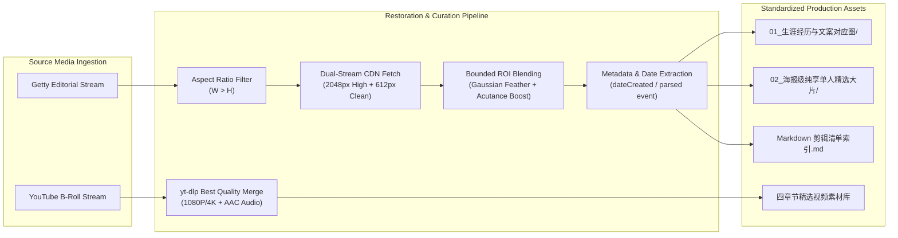

# 🌾 NBA Media Harvester (`nba-media-harvester`)

[](https://python.org)
[](#)
[](#)
[](#)
[](#)
[](LICENSE)

An automated visual media harvesting, 2048px watermark restoration, and documentary B-roll asset curation suite for **Antigravity**, sports video editors, and Python developers.

Easily extract, clean, and organize high-resolution editorial photos and raw YouTube documentary videos into production-ready, chronologically sorted asset libraries for NBA documentaries and short-form sports features.

---

## ✨ Key Highlights

- **🎯 Mathematically Bounded 2048px Watermark Restoration**:
  - Automatically fetches the `2048x2048` high-resolution source and `w=0` clean unwatermarked reference patch from Getty CDNs.
  - Aligns dimensions via Lanczos upscaling and counter-acts softness with localized high-frequency sharpening (`UnsharpMask(radius=1.8, percent=220, threshold=1)`).
  - Strictly constrains the blend mask to the calibrated ROI ($y: 60.8\% \sim 72.3\% \cdot H$, $x: 58.0\% \sim 100\% \cdot W$) with Gaussian edge feathering ($r=8$).
  - Eliminates false positive replacements on player jerseys/numbers and crops the bottom 60px metadata ID bar.
  - Boosts global micro-contrast acutance (`UnsharpMask(radius=1.2, percent=95, threshold=2)`).
- **📐 100% Horizontal Landscape Enforcement**:
  - Strict algorithmic filter ($W > H$) prevents vertical portraits or cropped ratios from entering 16:9 documentary timelines.
- **🎬 Documentary-Grade YouTube B-Roll Harvester**:
  - Automatically curates non-game narrative footage: Draft podium calls, jersey unveilings, private offseason workouts (Chris Johnson, Rico Hines), and in-depth player podcasts.
  - Automatically downloads and multiplexes best video + audio streams via `yt-dlp`.
- **📂 Chronological Archiving & Dual-Tier Organization**:
  - Separates assets into `01_生涯经历与文案对应图/` (milestones sorted by player career dates) and `02_海报级纯享单人精选大片/` (high-impact solo portraits/action shots).
  - Standardized Chinese naming convention: `序号_YYYY-MM-DD_事件或画面描述_图片ID.jpg`.
  - Automatically generates rich Markdown index catalogs with clickable file URLs.

---

## 🏗️ Architecture



---

## 🚀 Quick Start

### 1. Requirements

- Python 3.10+
- `Pillow`, `numpy`
- `yt-dlp` & `ffmpeg` (for video downloading)
- `curl`

Install Python dependencies:
```bash
pip install pillow numpy
```

### 2. CLI Usage

#### Harvest Full Photo Suite for an NBA Player:
```bash
python3 scripts/getty_harvester.py \
    --player "凯德·坎宁安" \
    --en-name "Cade Cunningham" \
    --solos 25
```

#### Restore a Single Getty Image by Asset ID:
```bash
python3 scripts/watermark_restorer.py \
    --id 2297624955 \
    --out ~/Downloads/restored_image.jpg
```

#### Harvest Documentary Videos:
```bash
python3 scripts/youtube_harvester.py \
    --player "沃克·凯斯勒" \
    --en-name "Walker Kessler"
```

---

## 💻 Python API

```python
from scripts.getty_harvester import harvest_player_assets
from scripts.watermark_restorer import restore_by_asset_id

# 1. Single Asset Restoration
img = restore_by_asset_id("2297624955", out_path="restored_sample.jpg")
print(f"Restored resolution: {img.size[0]}x{img.size[1]}")

# 2. Batch Harvesting Pipeline
harvest_player_assets(
    player_name="雅克塞尔·伦德博格",
    en_name="Yaxel Lendeborg",
    output_dir="~/Downloads/伦德博格_高清素材",
    solo_count=30
)
```

---

## 📁 Directory Layout

```text
nba-media-harvester/
├── SKILL.md                  # Antigravity skill specification and guidelines
├── README.md                 # Project documentation
├── LICENSE                   # MIT License
├── .gitignore                # Git ignore rules
├── scripts/
│   ├── __init__.py           # Package exports
│   ├── watermark_restorer.py # Mathematical ROI restoration engine
│   ├── getty_harvester.py    # Getty Images photo pipeline & organizer
│   └── youtube_harvester.py  # YouTube documentary B-roll harvester
└── examples/
    └── demo_harvest.py       # Quick demonstration script
```

---

## 📜 License

MIT License. Copyright (c) 2026 YoungG97.
