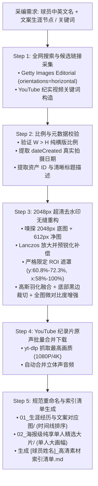

# NBA Media Harvester (NBA 媒体素材智能采编与高清重构套件)

专门针对体育人物志与 NBA 球员深度纪录片打造的**广播级视觉素材智能采编、超清无缝去水印重构与多媒体资产标准化管理套件**。

本 Skill 彻底解决了传统体育视频创作中**素材清晰度低、水印破坏主体、非横版比例破坏构图、视频素材雷同碎片化、无结构化归档命名**的核心痛点，将 Getty Images 与 YouTube 等顶级平台转化为即开即用的 1080P/4K 纪录片级工业化素材库。

---

## 📸 核心技术标准与工业级规范

### 1. 2048px 超清去水印无缝重构算法 (Mathematical ROI Feathered Blending)
- **双流 CDN 自动嗅探**：
  - **底图流**：自动嗅探 `2048x2048`（或 `1024x1024`）高分辨率源图，保留极致的球衣织物纹理、面部汗水细节与景深层次。
  - **净图流**：自动抓取无水印 `w=0`（通常为 `612x612` 或 `594x594`）作为无损修补基底。
- **几何尺度严密对齐**：使用 Lanczos 高阶重采样将净图拉伸至与高清图相同的全画幅分辨率 $(W, H)$。
- **预锐化消除模糊 (Acutance Compensation)**：
  - 对放大后的净图预先施加 `UnsharpMask(radius=1.8, percent=220, threshold=1)`，彻底抵消因低分辨率上采样造成的边缘柔化。
- **严格数学限定 ROI 遮罩 (Strict Bounding Box)**：
  - **垂直方向**：严格限定于高度的 $60.8\% \sim 72.3\%$（即 $y_1 = \lfloor 0.608 \times H \rfloor, y_2 = \lfloor 0.723 \times H \rfloor$）。
  - **水平方向**：严格限定于宽度的 $58.0\% \sim 100\%$（即 $x_1 = \lfloor 0.580 \times W \rfloor, x_2 = W$）。
  - **羽化过渡**：在 ROI 矩形区域应用半径为 8 像素的高斯模糊滤波（`GaussianBlur(radius=8)`），实现边缘零接缝融合。
- **剔除底部编号黑边**：严格在图层融合完成后，自下而上裁切底部 60 像素的媒体编号黑条（$H \le 800$ 时裁切 30 像素）。
- **全图微反差增强**：全局施加微反差高锐度滤镜（`UnsharpMask(radius=1.2, percent=95, threshold=2)`），让球场光影质感更加通透。

---

### 2. 100% 纯横版构图校验 (Horizontal Landscape Enforcement)
- **比例铁律**：所有采编入库的照片素材必须严格满足 $W > H$（宽 > 高）。
- **杜绝竖图拉伸**：自动剔除竖版全身构图或特写，严禁在后续纪录片 16:9 画幅中出现两侧尴尬大黑边或失真裁剪。

---

### 3. YouTube 纪录片级原声视频采编 (Documentary Narrative Curation)
- **非比赛场景优先**：精准聚焦于具备故事冲突与情绪张力的场外纪实：
  1. **选秀与起点**：选秀大会首轮叫号时刻、登台致辞、球衣首次亮相发布会。
  2. **拼搏与自律**：休赛期 Chris Johnson、Rico Hines 等名师私人魔鬼特训、清晨 6 点投篮训练原片。
  3. **球风与招牌**：4K 60fps 慢动作特写与脚步分解。
  4. **门面与访谈**：球员官方媒体日专访、保罗·乔治 / 雷迪克等大牌播客长篇深度对谈。
- **最高画质合并**：调用 `yt-dlp` 自动抓取 `bv*+ba/b` 并通过 FFmpeg 封装为标准的 `.mp4`。

---

### 4. 目录分流与带日期规范命名 (Chronological Archiving)
采编生成的素材必须自动存放至标准化的双层目录中：
```text
[球员姓名]_高清图片素材/
├── 01_生涯经历与文案对应图/
│   ├── 01_YYYY-MM-DD_事件或节点描述_资产ID.jpg
│   ├── 02_YYYY-MM-DD_事件或节点描述_资产ID.jpg
│   └── ...
├── 02_海报级纯享单人精选大片/
│   ├── 01_YYYY-MM-DD_赛场高光或肖像描述_资产ID.jpg
│   ├── 02_YYYY-MM-DD_赛场高光或肖像描述_资产ID.jpg
│   └── ...
└── [球员姓名]_高清素材索引清单.md
```

- **第一目录（生涯经历图）**：必须根据球员生平传记（如：高中、NCAA、选秀、新秀赛季、首个重大荣誉、顶薪续约、爆发之夜）按时间先后严格排序。
- **第二目录（海报大片图）**：必须为单人纯享、背景干净或赛场张力极强的大画幅横版。
- **命名结构**：统一使用中文，并严格包含：
  $$\text{序号}\_\text{YYYY-MM-DD}\_\text{事件/画面描述}\_\text{图片ID}.\text{jpg}$$

---

## 🚦 采编工作流全景



---

## 💻 快速调用指南 (CLI & Python API)

### 1. 命令行一键采编

```bash
# 采编球员全部高清图片素材（包含 25 张单人海报横版大片）
python3 ~/.gemini/config/skills/nba-media-harvester/scripts/getty_harvester.py \
    --player "凯德·坎宁安" \
    --en-name "Cade Cunningham" \
    --solos 25

# 单张 Getty 资产 ID 极速去水印重构
python3 ~/.gemini/config/skills/nba-media-harvester/scripts/watermark_restorer.py \
    --id 2297624955 \
    --out ~/Downloads/restored_sample.jpg

# 采编 YouTube 纪录片级视频片段
python3 ~/.gemini/config/skills/nba-media-harvester/scripts/youtube_harvester.py \
    --player "沃克·凯斯勒" \
    --en-name "Walker Kessler"
```

### 2. Python API 调用

```python
from scripts.getty_harvester import harvest_player_assets
from scripts.watermark_restorer import restore_watermark, restore_by_asset_id

# 1. 直接通过资产 ID 重构单张超清无水印图片
img = restore_by_asset_id("2297624955", out_path="restored.jpg")
print(f"重构完成，尺寸: {img.size}")

# 2. 传入生涯节点定制采编
milestones = [
    {
        "asset_id": "1331396018",
        "name": "01_2021-07-29_NBA选秀大会状元及第与肖华拥抱名场面_1331396018",
        "desc": "选秀大会状元及第与总裁肖华拥抱时刻",
        "date": "2021-07-29"
    }
]

harvest_player_assets(
    player_name="凯德·坎宁安",
    en_name="Cade Cunningham",
    output_dir="~/Downloads/坎宁安高清素材",
    milestones=milestones,
    solo_count=20
)
```

---

## ⚠️ 避坑指南与质量红线

1. **绝对禁止全图差分抠图**：
   - 曾有算法尝试通过 `diff > 16` 对全图进行差异提取，但在球员球衣号码（如 76 人、活塞等白色/反光球衣）处发生大面积误判，导致胸前球衣被错误替换为低清像素。**必须严格限定在右下角水印 ROI 内进行融合**。
2. **严禁在融合前裁切底部黑边**：
   - 早期测试如果在融合前直接对高清图裁切 60px，由于净图未裁切，二者高度不一致拉伸后会导致图像产生垂直位移（例如出现“手腕骨折”或“球衣错位”）。**必须先全画幅对齐融合，最后一步统一裁切**。
3. **横向起始坐标严控在 58%**：
   - 若将横向起点设为 60% 宽度，在全黑背景的定妆照中，水印最左侧的文字边缘会在暗部留下一条约 28px 的微弱分界线。**设为 58.0% 宽时恰好完整覆盖且过渡极其自然**。
